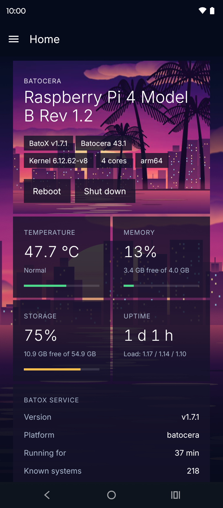
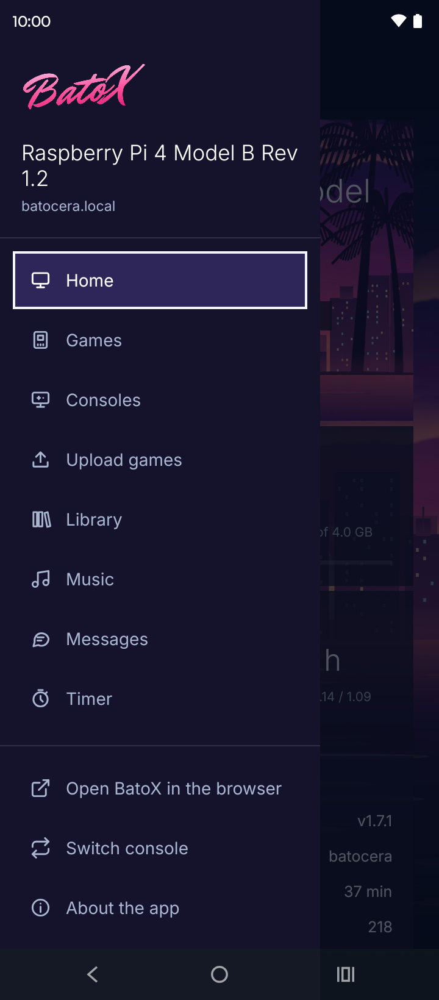
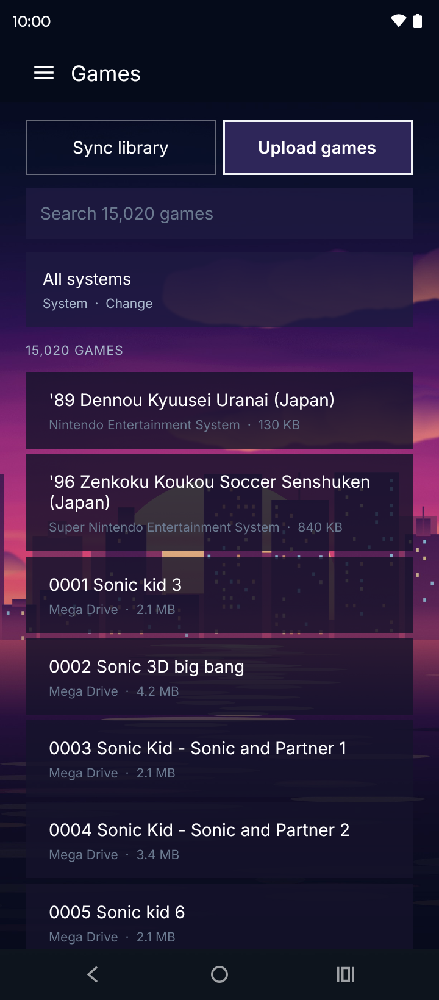
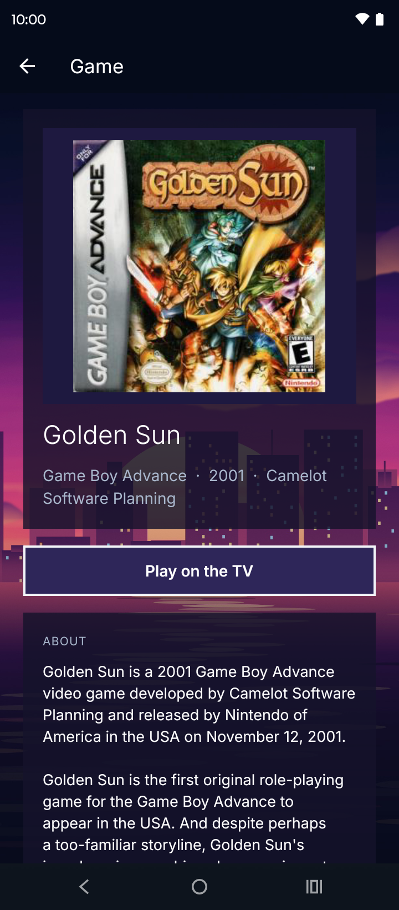
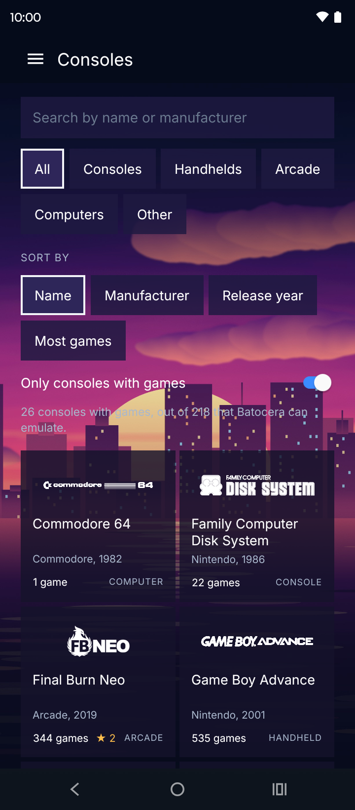
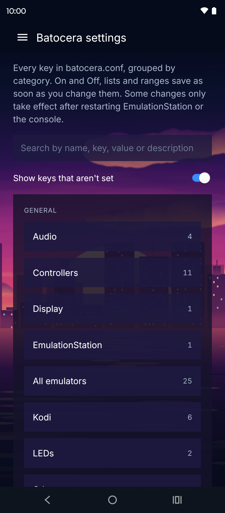
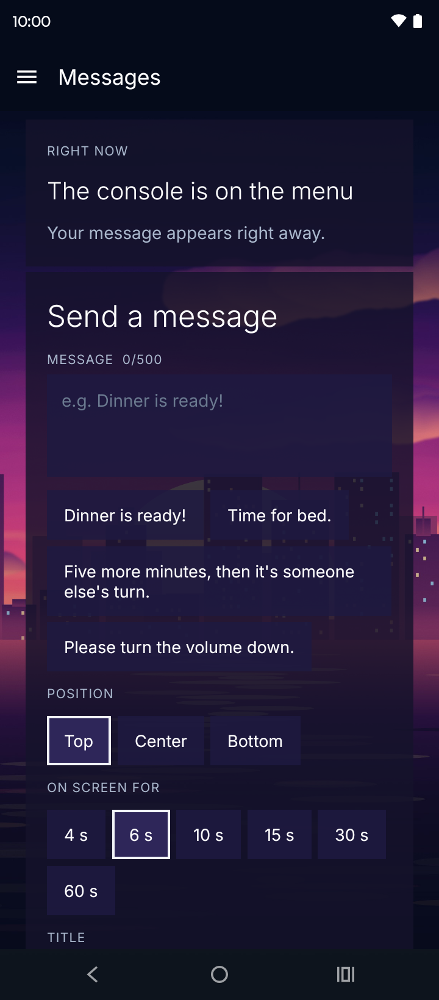
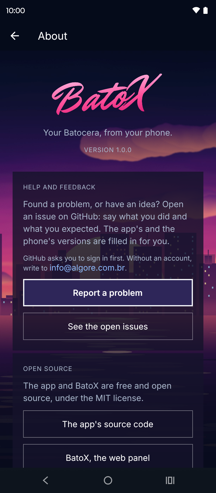

# batox-mobile

BatoX for iOS and Android: install [BatoX](https://github.com/monteirohat/BatoX) on your Batocera
console and manage it from your phone. Built with Expo (React Native).

> **Status:** version 1.0.0, on its way to Google Play, published by Algore Tecnologia. The app
> installs and updates BatoX on a console, connects to one that already runs it, and has every
> screen of the web panel: the games (and playing one on the TV), uploading games and music,
> messages on the TV, the play timer, closing the running game, EmulationStation, video, audio,
> Batocera's settings, the game library, consoles, extensions, logs and API access. The App Store
> comes after.

| Home | Menu | Games | A game |
|---|---|---|---|
|  |  |  |  |

| Consoles | Batocera settings | Messages | About |
|---|---|---|---|
|  |  |  |  |

## What it does

1. **Install BatoX** on a Batocera console, as the
   [BatoX Installer](https://github.com/monteirohat/BatoX_Installer) does on a computer: type the
   console's address and SSH login, check the console, pick a version (the latest is chosen).
   The console downloads the release from GitHub and checks its SHA-256 sums (a file missing from
   them stops the install), then the app installs the service, starts it, waits for it to answer,
   and shows the address and the access token. The token is kept in the phone's secure storage
   (Keychain, Android Keystore). Updating and reinstalling keep the console's token, settings and
   catalog. The app remembers each console's SSH host key: when it changes, the password isn't
   sent until you trust the new key. The SSH password itself is never saved.

2. **Connect** to a console that already runs BatoX, with its address and access token. The app
   checks both (BatoX answers, the token is taken) before keeping them.
3. **A console's home**, as the web panel's dashboard: the console over the sunset (its model, BatoX
   and Batocera versions, Reboot and Shut down), the game being played with its cover, and
   temperature, memory, storage and uptime, each with a bar that turns yellow then red. The app
   opens on the console it used last; a side menu holds the console's features, Open BatoX in the
   browser, and Switch console (open another, add one, install BatoX on one, or forget one).

4. **Games**, as on the web panel: every game on the console in one list, with a search (it
   ignores case and accents), a system, Sync library and Upload games; then a game: its cover and
   what EmulationStation scraped (description, publisher, genre, players, rating, times played),
   **Play on the TV** and Delete. When another game is running, the app asks before closing it.
5. **Upload games** from the phone: choose the system (every Batocera system, A to Z, with a
   search, as on the web panel), pick files with the system's file picker, and they go one at a
   time to its folder, each with its progress. Files the system doesn't take, and games already on
   the console, are skipped with the reason.
6. **Music**: the menus' background music, by folder (main, or a system's); upload tracks the same
   way, or delete one.
7. **Send a message** to the TV, even during a game: quick messages, and where, how long and
   under which title it shows, as on the web panel's Messages screen.
8. **Play timer**: a countdown on the TV, then BatoX closes the game, turns the console off or only
   shows that the time is up; add 5 or 15 minutes, or cancel it.
9. **Close the game** that is running, from the console's screen.
10. **Extensions** from the official catalog: the installed ones (on or off, update, restart,
    remove) with their settings, in the control each manifest asks for, and their log; and the
    catalog's, with what each may do, before installing.
11. **Logs**: BatoX's activity and errors, and EmulationStation's log, newest first.
12. **EmulationStation**: reload the game lists, restart, stop or start it; edit es_settings.cfg
    (search, change or add a setting, with or without a restart); install a theme from a .zip;
    and its log, which can be cleared.
13. **Video**: the screens connected now, which one shows EmulationStation and the games, and
    whether the second one stays on. The change applies when the console restarts, which the app
    offers.
14. **Audio**: where the sound comes out (a screen over HDMI, the headphone jack, USB or
    Bluetooth), a test sound, and a shortcut when the sound isn't on the main screen.
15. **Consoles**: every system Batocera can emulate, as cards with the system's logo in white
    (the theme's, with the dark or gray plate some logos come on cut off, as on batox-theme), a
    search, its type, the order, and only the ones with games; then a system's details, its ROM
    folder and accepted files, Show games (the Games list, on that system) and Upload games.
16. **Batocera settings**: every key in batocera.conf by category (general, then per game
    system), each with its control: On and Off, a list (a long one opens a list with a search), a
    range, a number, text or a password; a search over all keys; and a new key, such as a
    per-game one.
17. **Library**: download games from your own library (a library.json at an address you choose):
    search, system, only those not on the console, one or many at a time, with covers.
18. **Access**: the address and token the phone uses (show, copy, test, change), and the routes
    of the console's BatoX.
19. **About the app** (in the side menu and the list of consoles): its version, **Report a
    problem** (a new GitHub issue with the app's and the phone's versions filled in, or an email
    for those without a GitHub account), the source code, the publisher, the privacy policy and
    the license.

## What comes next

1. **Google Play**: the closed test, then production; the steps and the Play Console's answers
   are in [docs/google-play.md](docs/google-play.md).
2. **The App Store**, with the same build profiles.
3. **New BatoX features** come to the app as they reach the web panel, through BatoX's
   [API](https://github.com/monteirohat/BatoX/blob/main/docs/api.md).

## Look

The same as BatoX's web panel and the [batox-theme](https://github.com/monteirohat/batox-theme):
flat dark indigo surfaces over a sunset picture, white type in Inter, one white frame on the main
action, square corners. The tokens are in [src/theme/tokens.ts](src/theme/tokens.ts); a screen
names a token and never writes a color, a size or a font itself.

## How it talks to the console

Installing goes over SSH, and the app carries its own small SSH client in TypeScript
([src/ssh/](src/ssh/)): React Native has no SSH, and the native libraries for it are old or hard to
build. It speaks a modern set that every current OpenSSH and Dropbear (Batocera's SSH server)
offer, on the audited [@noble](https://paulmillr.com/noble/) cryptography: curve25519-sha256 key
exchange, Ed25519 and ECDSA P-256 host keys, AES-CTR with HMAC-SHA-256, password sign-in, and
commands with their output and exit code. It also guards against the Terrapin attack (strict key
exchange).

Under it, a small native module ([modules/batox-tcp/](modules/batox-tcp/)) opens the TCP
connection with the system's own API: `java.net.Socket` on Android, `Network.framework` on iOS.

## Development

Needs Node 22 or newer. Expo's own guidance for this project is in [AGENTS.md](AGENTS.md).

```bash
npm install
npx expo run:android # builds the app with its native module and opens it on an emulator or phone
npx expo run:ios     # the same for iOS (needs Xcode 16.1 or newer)
npm start            # the dev server alone, once the app is installed
npm run typecheck
npm run lint
npm test             # unit tests of the SSH client's building blocks
npm run doctor       # expo-doctor: dependency and config checks

CONSOLE=192.168.0.10 npx tsx tools/ssh-smoke.ts       # the SSH client against a real console, from a computer
CONSOLE=192.168.0.10 npx tsx tools/install-smoke.ts   # the install steps against a real console (reinstalls BatoX)
```

The app has native code of its own (the TCP module), so it runs in a development build, not in
Expo Go. On a Mac whose default Java doesn't run, point `JAVA_HOME` at Android Studio's
(`/Applications/Android Studio.app/Contents/jbr/Contents/Home`).

### Builds with EAS

Store builds, and iOS builds, run on Expo's servers
([EAS Build](https://docs.expo.dev/build/introduction/)), with the profiles in
[eas.json](eas.json). The project belongs to the `algore-tecnologia` Expo organization (`owner`
and `extra.eas.projectId` in `app.json`); sign in with an account that is a member of it:

```bash
npx eas-cli@latest login
```

Then:

```bash
npx eas-cli@latest build --profile development-simulator --platform ios   # for the iOS simulator; no Apple account needed
npx eas-cli@latest build --profile development --platform android         # an APK to install on an Android phone
npx eas-cli@latest build --profile development --platform ios             # for an iPhone: needs the Apple Developer Program,
                                                                          # and the phone registered with `eas device:create`
npx eas-cli@latest build --profile production --platform android          # the bundle for Google Play (docs/google-play.md)
```

A development build loads the JavaScript from `npm start` on the computer, on the same network.

- Screens are in `src/app/` (Expo Router: one file per screen); components in `src/components/`.
- Add packages with `npx expo install <package>`, so their versions match the Expo SDK.
- The `ios/` and `android/` folders are generated and not kept in git; native settings go in
  `app.json`.
- The images in `assets/images/` (icon, splash, wordmark, backdrop) are drawn from the BatoX
  Installer's icon, the web panel's wordmark and the theme's sunset scene by
  `python3 tools/render-assets.py`, which reads those repositories from the same folder as this
  one and needs Google Chrome. The Play listing's icon and feature graphic, in `store/android/`,
  come from `python3 tools/render-store.py`; its screenshots from the app (see
  [docs/google-play.md](docs/google-play.md)).

## Privacy

No account, analytics or ads: the app talks only to your consoles and to GitHub (to list BatoX's
releases). See the [privacy policy](PRIVACY.md).

## Support the project

The app and BatoX are free and will stay free. If they are useful to you and you want to support
the project, any amount helps.

<p>
  <a href="#support-the-project"></a>
  <a href="https://revolut.me/andrludegv"></a>
  <a href="https://www.paypal.me/AMonteiro818"></a>
</p>

- **PIX**, from Brazil: use this random key in the app of your bank.

  ```
  abf3de6b-bad4-4225-8667-c941ebd31039
  ```

- **Revolut**, from anywhere: open [revolut.me/andrludegv](https://revolut.me/andrludegv), or send
  to the tag **@andrludegv** in the app.

- **PayPal**, from anywhere: open [paypal.me/AMonteiro818](https://www.paypal.me/AMonteiro818) and
  choose the amount.

## License

[MIT](LICENSE). BatoX is an independent project, not affiliated with or endorsed by the Batocera
project.
